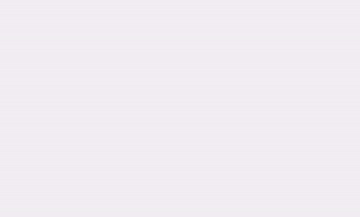
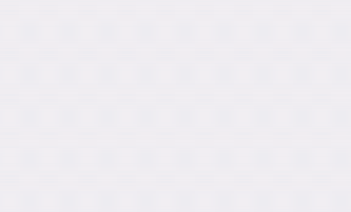
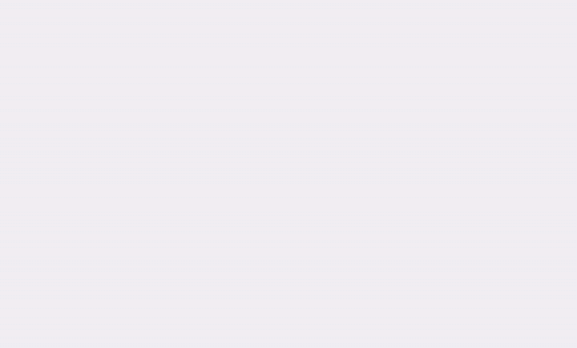
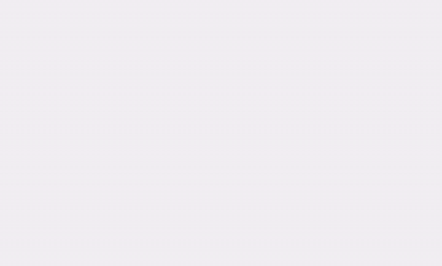

# React Design Cursor

An interactive React component that simulates a designer outlining your UI in real time: an animated cursor drags out selection boxes, shows live dimensions, and reveals each element as it goes. Use the flat **minimal** look, the **gradient** look with dust and breathing glow, or mix every effect yourself through props.

[](https://www.npmjs.com/package/react-design-cursor)
[](https://opensource.org/licenses/MIT)

---

## Live demos

<table>
  <tr>
    <td align="center"><b>Gradient</b> (default)<br/></td>
    <td align="center"><b>Minimal</b><br/></td>
  </tr>
  <tr>
    <td align="center"><b>Custom palette</b><br/></td>
    <td align="center"><b>Mixed</b> (minimal cursor, gradient boxes)<br/></td>
  </tr>
</table>

---

## Features

- 🖱️ **Human-like motion:** smooth, curved cursor paths with eased speed, a soft click, and optional tilt.
- 📐 **Automated wireframing:** walks your component tree and draws a box around each element, with name tags and live `w × h` readouts.
- 🎨 **Two variants, fully customizable:** `minimal` (flat dashed boxes, plain cursor) and `gradient` (aurora palette, glow, orbiting light, breathing aura, dust). Every effect can be switched on or off individually.
- ✨ **Effects you can mix:** cursor dust, click bursts, iris or fade reveal, gradient breathing outline, corner handles, and more.
- 🧠 **Smart element profiling:** elements are classified as `frame`, `card`, `item` or `quick` to get sensible timing automatically.
- 👁️ **Smart triggers:** start on mount, or when scrolled into view with `IntersectionObserver`.
- ⚡ **Performance-minded:** pooled dust particles, one layout read per pass, compositor-friendly animations, and automatic cleanup.
- ♿ **Accessible and SSR safe:** respects `prefers-reduced-motion` and shows content normally without JavaScript.
- 🧩 **Typed:** written in TypeScript with exported prop types.

---

## Installation

```bash
# npm
npm i react-design-cursor
```
```bash
# pnpm
pnpm add react-design-cursor
```

```bash
# yarn
yarn add react-design-cursor
```

Requires React 16.8 or newer (hooks). The component uses modern CSS (`color-mix()`) and the Web Animations API, which all current browsers support.

---

## Quick start

Wrap any section you want to bring to life:

```tsx
import { DesignCursor } from "react-design-cursor";

export const MyComponent = () => (
  <DesignCursor label="Lead Designer" loop>
    <div style={{ padding: 40, background: "#f8fafc", borderRadius: 16 }}>
      <h2>My Awesome Feature Section</h2>
      <p>This entire block will be outlined and "designed" by an animated cursor!</p>
    </div>
  </DesignCursor>
);
```

With no other props you get the **gradient** look. Switch to the original flat look with one prop:

```tsx
<DesignCursor variant="minimal" color="#3b82f6">
  …
</DesignCursor>
```

---

## Variants

A variant is a starting preset. Every option can still be overridden on top of it.

| | `minimal` | `gradient` (default) |
|---|---|---|
| Cursor | plain arrow in `color` | gradient arrow, rotating aurora halo, tilt, click squish |
| Box | flat dashed outline, faint tint, square corner handles | gradient hairline, orbiting light, glow, **breathing aura** |
| Labels | solid colored chips | dark chips with a hairline border |
| Click | simple ring | ring + dust burst |
| Cursor trail | none | fine dust |
| Reveal | fade | iris bloom + gradient breathing outline |

---

## Props

### General

| Prop | Type | Default | Description |
| :--- | :--- | :--- | :--- |
| `children` | `React.ReactNode` | **Required** | The UI you want wrapped and animated. |
| `variant` | `"minimal" \| "gradient"` | `"gradient"` | Starting preset for every option below. |
| `color` | `string` | `"#7c5cff"` | Primary CSS color. It is the first color of the aurora palette. |
| `colors` | `string[]` (2+) | `undefined` | Custom palette. When omitted, an aurora palette built from `color` is used if any gradient feature is on, otherwise one flat color. |
| `label` | `string` | `"Designer"` | Name tag shown next to the cursor. |
| `speed` | `number` | `1` | Speed multiplier (`2` = twice as fast). |
| `loop` | `boolean` | `false` | Replay forever while in view. |
| `replay` | `boolean` | `true` | Replay when scrolled out of view and back in. |
| `loopDelay` | `number` | `2800` | Pause between loops, in ms. |
| `startDelay` | `number` | `500` | Delay before the first run, in ms. |
| `maxDepth` | `number` | `3` | How deep into the child tree to draw boxes (`1` = direct children only). |
| `maxSteps` | `number` | `14` (`80` with `selector`) | Safety cap on boxes drawn per run. |
| `selector` | `string` | `undefined` | CSS selector to target specific elements instead of walking the whole tree. |
| `quickSelector` | `string` | `undefined` | Matching elements get very fast boxes with no tags (great for icon grids). |
| `trigger` | `"mount" \| "inView"` | `"inView"` | Start on mount or when scrolled into view. |
| `onComplete` | `() => void` | `undefined` | Called after each full pass finishes. |
| `className` | `string` | `undefined` | Class applied to the wrapper. |
| `style` | `React.CSSProperties` | `undefined` | Inline styles applied to the wrapper. |

### `cursor={{ … }}`

| Option | Values | `minimal` | `gradient` | Description |
| :--- | :--- | :--- | :--- | :--- |
| `style` | `"plain" \| "gradient"` | `plain` | `gradient` | Solid arrow or palette-filled arrow. |
| `size` | `number` (px) | `22` | `24` | Arrow size. |
| `halo` | `boolean` | `false` | `true` | Soft rotating aurora orb behind the arrow. |
| `tilt` | `boolean` | `false` | `true` | Arrow leans with its horizontal speed. |
| `clickSquish` | `boolean` | `false` | `true` | Press-in and rebound on each click. |
| `showLabel` | `boolean` | `true` | `true` | Show the name tag beside the cursor. |

### `box={{ … }}`

| Option | Values | `minimal` | `gradient` | Description |
| :--- | :--- | :--- | :--- | :--- |
| `style` | `"dashed" \| "gradient"` | `dashed` | `gradient` | Flat dashed outline or gradient hairline ring. |
| `radius` | `"match" \| number` | `0` | `"match"` | Copy each element's own border radius, or use a fixed px radius. |
| `fill` | `boolean` | `true` | `true` | Faint tint while the box is drawn. |
| `glow` | `boolean` | `false` | `true` | Blurred palette glow behind the box. |
| `orbit` | `boolean` | `false` | `true` | A comet of light circling the border. |
| `breathing` | `boolean` | `false` | `true` | Gradient aura that softly swells and relaxes around the box. |
| `handles` | `"none" \| "square" \| "dot"` | `square` | `none` | Corner handles. |
| `showName` | `boolean` | `true` | `true` | Element name above the box. |
| `showSize` | `boolean` | `true` | `true` | Live `w × h` readout below the box. |

### `tag={{ … }}`

| Option | Values | `minimal` | `gradient` | Description |
| :--- | :--- | :--- | :--- | :--- |
| `style` | `"solid" \| "dark"` | `solid` | `dark` | Colored chip or dark chip with a hairline border. |
| `radius` | `number` (px) | `4` | `4` | Label corner radius. |

### `effects={{ … }}`

| Option | Values | `minimal` | `gradient` | Description |
| :--- | :--- | :--- | :--- | :--- |
| `dust` | `boolean` | `false` | `true` | Fine dust shed from the cursor as it moves. |
| `click` | `"none" \| "ring" \| "burst"` | `ring` | `burst` | Click feedback: nothing, a ring, or a ring plus a dust burst. |
| `reveal` | `"none" \| "fade" \| "iris"` | `fade` | `iris` | How the real element appears. |
| `revealOutline` | `"none" \| "solid" \| "gradient"` | `none` | `gradient` | Outline that breathes out from the element as it appears. |

### `performance={{ … }}`

| Option | Values | Default | Description |
| :--- | :--- | :--- | :--- |
| `maxParticles` | `number` | `320` | Hard cap on live dust particles. |
| `particleDensity` | `0`–`1` or `"auto"` | `"auto"` | Dust amount. `"auto"` uses fewer particles on devices with 4 or fewer cores. |
| `irisBlurMaxArea` | `number` (px²) | `250000` | The iris reveal skips its blur on elements larger than this. |

### Per-element attributes

Put these on elements inside the component:

| Attribute | Example | Effect |
| :--- | :--- | :--- |
| `data-dc="card"` | `<div data-dc="card">` | Uses the slower, larger "card" timing. |
| `data-dc-name` | `<div data-dc-name="Hero">` | Sets the name shown on that element's box (defaults to the tag name). |

---

## Examples

### 1. Original flat look, in blue


```tsx
import { DesignCursor } from "react-design-cursor";

export const Features = () => (
  <DesignCursor variant="minimal" color="#3b82f6" label="Designer">
    <section style={{ padding: 32, background: "#fff", borderRadius: 20 }}>
      <h2>Ship interfaces faster</h2>
      <p>Everything you need to design, preview and launch.</p>
      <div style={{ display: "grid", gridTemplateColumns: "repeat(3, 1fr)", gap: 14 }}>
        <div data-dc="card">Design</div>
        <div data-dc="card">Preview</div>
        <div data-dc="card">Launch</div>
      </div>
    </section>
  </DesignCursor>
);
```

### 2. Gradient look (default)


```tsx
<DesignCursor label="Lead Designer">
  <section style={{ padding: 32, background: "#fff", borderRadius: 20 }}>
    …
  </section>
</DesignCursor>
```

### 3. Your own palette


```tsx
<DesignCursor
  label="Aurora"
  colors={["#00f5a0", "#00d9f5", "#7c5cff"]}
  box={{ orbit: false }}
>
  …
</DesignCursor>
```

### 4. Mix and match

A flat blue cursor with gradient boxes, a breathing aura, dust and an iris reveal.


```tsx
<DesignCursor
  variant="minimal"
  color="#3b82f6"
  label="Hybrid"
  box={{ style: "gradient", breathing: true, handles: "none" }}
  tag={{ style: "dark" }}
  effects={{ dust: true, reveal: "iris", revealOutline: "gradient" }}
>
  …
</DesignCursor>
```

### 5. Calmer gradient (no dust, no bursts)

```tsx
<DesignCursor effects={{ dust: false, click: "ring" }}>
  …
</DesignCursor>
```

### 6. Cursor only, no labels or readouts

```tsx
<DesignCursor
  box={{ showName: false, showSize: false, glow: false, breathing: false }}
>
  …
</DesignCursor>
```

### 7. Target specific elements and speed up icon grids

```tsx
<DesignCursor
  selector="[data-design]"
  quickSelector=".icon"
  maxSteps={40}
>
  <header data-design>…</header>
  <div className="icons">
    {icons.map((i) => (
      <span key={i} className="icon" data-design />
    ))}
  </div>
</DesignCursor>
```

### 8. Loop and react when a pass finishes

```tsx
<DesignCursor
  loop
  loopDelay={4000}
  speed={1.5}
  trigger="mount"
  onComplete={() => console.log("pass finished")}
>
  …
</DesignCursor>
```

### 9. Name boxes and mark cards

```tsx
<DesignCursor>
  <div data-dc="card" data-dc-name="Hero">…</div>
  <div data-dc="card" data-dc-name="Pricing">…</div>
  <button data-dc-name="CTA">Get started</button>
</DesignCursor>
```

### 10. Next.js (App Router)

The component uses browser APIs, so use it from a client component:

```tsx
"use client";

import { DesignCursor } from "react-design-cursor";

export default function Hero() {
  return (
    <DesignCursor>
      …
    </DesignCursor>
  );
}
```

---

## TypeScript

All prop types are exported:

```tsx
import type {
  DesignCursorProps,
  Variant,
  CursorOptions,
  BoxOptions,
  TagOptions,
  EffectOptions,
  PerfOptions,
} from "react-design-cursor";
```

You can also read the presets directly:

```tsx
import { MINIMAL_PRESET, GRADIENT_PRESET } from "react-design-cursor";
```

---

## How it works

1. **Walk:** the component collects the elements inside it (up to `maxDepth` levels, or those matching `selector`) and measures them once.
2. **Hide:** the real elements are hidden so nothing flashes before the animation.
3. **Design:** a cursor travels to each element's corner, clicks, and drags a box open to its size, showing its name and dimensions.
4. **Reveal:** as each box completes, the real element appears with the chosen reveal effect and the box winds down.
5. **Exit:** the cursor leaves and everything is restored to normal.

Elements are timed by profile: `frame` (the wrapper), `card` (`data-dc="card"`), `item` (everything else) and `quick` (matches `quickSelector`).

---

## Performance

- Dust particles are **pooled and reused**, so there is no DOM churn while they spawn and fade.
- All layout is **measured once** at the start of a pass, so nothing forces a re-layout between boxes.
- Animations use **transforms and opacity** wherever possible, so they stay off the main thread.
- Infinite animations (orbiting light, breathing aura) are **stopped once a box settles**.
- Cancelling a run (scrolling away, unmounting) **aborts pending timers and animations immediately**.
- Inline object props such as `box={{ … }}` do **not** restart the animation on every render.

For very large pages, lower `maxSteps`, use `quickSelector` for repeated items, or set `performance={{ particleDensity: 0.5 }}`.

---

## Accessibility

- If the user prefers reduced motion (`prefers-reduced-motion: reduce`), the animation is skipped and the content is shown immediately.
- Without JavaScript, a `<noscript>` rule keeps the content visible.
- The effect layer is `aria-hidden` and ignores pointer events, so it never interferes with your UI.

---

## Troubleshooting

| Problem | Fix |
| :--- | :--- |
| Content stays invisible | Check the browser console for errors. The wrapper hides content until the animation runs. |
| Animation never starts | With `trigger="inView"` the wrapper must be visible in the viewport. Try `trigger="mount"`. |
| Too many or too few boxes | Adjust `maxDepth`, `maxSteps`, or use `selector`. |
| Gradient looks flat | Pass `colors` with 2 or more different colors. A palette with one color is ignored. |
| Warning about container position | The wrapper is already `position: relative`. The warning usually comes from another library on the page. |
| Choppy on slow devices | Lower `particleDensity`, set `effects={{ dust: false }}`, or use `variant="minimal"`. |

---

## License

MIT